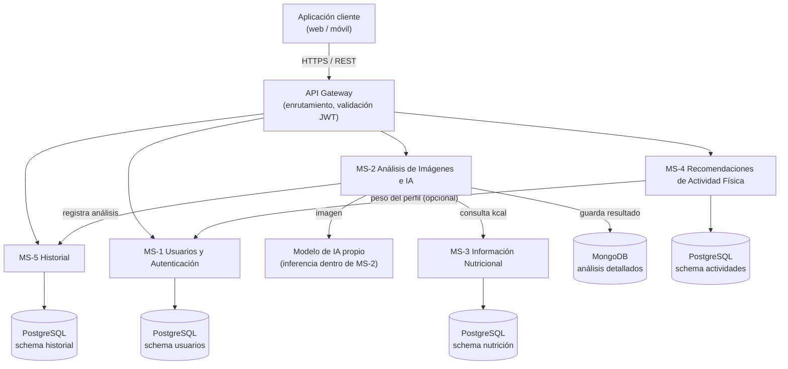

# Panda

**Agente inteligente para estimación de calorías mediante fotografías y recomendación de actividad física**

> Proyecto académico — Ingeniería en Sistemas Computacionales
> Instituto Tecnológico de Jiquilpan, Michoacán · Septiembre 2026

## Descripción

**Panda** es un sistema que permite al usuario tomar o cargar una fotografía de su comida. Un servicio de inteligencia artificial con visión por computadora identifica los alimentos presentes, estima sus porciones y calcula un valor calórico aproximado por alimento y para el total de la comida. Después, el agente propone distintas **alternativas de actividad física** con una duración estimada para gastar las calorías identificadas.

## Problema que resuelve

El registro manual de alimentos es tardado: hay que buscar cada producto, estimar cantidades y capturar datos. Además, existe una separación entre las apps que registran alimentos y la explicación sencilla de lo que una comida representa energéticamente. Panda reduce los pasos necesarios para obtener una referencia inicial usando una fotografía y un agente conversacional.

## Funcionalidades Principales

- Registro, inicio de sesión y edición de perfil (edad, sexo, peso, estatura).
- Captura o carga de imágenes desde la cámara o la galería.
- Detección de uno o varios alimentos en la fotografía.
- Estimación de porciones y calorías **por alimento** y **total** de la comida (mostrado como rango).
- Corrección manual de alimentos y porciones detectados por la IA.
- Generación de una lista de ejercicios con su duración según las calorías y el perfil del usuario.
- Historial de comidas, calorías y ejercicios recomendados.
- Estadísticas de consumo y calorías quemadas por periodo.
- Panel de administración: gestión de usuarios y de catálogos de alimentos y ejercicios.
- Mensajes claros de error y avisos de que los resultados son aproximados.

### Fuera del alcance

- Diagnósticos médicos o nutricionales.
- Sustituir la valoración de un nutriólogo, médico o entrenador.
- Garantizar una medición exacta de porciones solo a partir de una fotografía.
- Prescribir rutinas clínicas o tratamientos.
- Integración con dispositivos inteligentes o *wearables*.

## Flujo principal de uso

1. El usuario ingresa a Panda e inicia sesión (o crea una cuenta).
2. Selecciona la opción para analizar una comida.
3. Toma una fotografía o carga una imagen.
4. El sistema envía la imagen al servicio de análisis con IA.
5. La IA identifica los alimentos visibles.
6. El sistema obtiene la estimación calórica de cada alimento y calcula el total aproximado.
7. El agente genera varias alternativas de actividad física.
8. El usuario consulta el detalle, puede corregirlo y guardar el análisis en su historial.

**Ejemplo:** el usuario carga una foto con pollo, arroz y ensalada → Panda muestra las calorías de cada elemento, un total aproximado y varias actividades con duración estimada.

## Arquitectura

Panda se divide en **cinco microservicios independientes** más un **API Gateway** que centraliza las peticiones del cliente y valida el token JWT. Cada microservicio es dueño de su información y **no accede directamente a la base de datos de otro**.



| Microservicio | Responsabilidad | Base de datos | Consume |
|---|---|---|---|
| **API Gateway** | Punto único de entrada, enrutamiento y validación del JWT | — | MS-1 a MS-5 |
| **MS-1 Usuarios y Autenticación** | Registro, inicio de sesión, roles (usuario/administrador) y perfil opcional | PostgreSQL | — |
| **MS-2 Análisis de Imágenes e IA** | Recibe la foto, la procesa con el modelo de IA propio, valida el resultado y calcula las calorías | MongoDB | Modelo de IA, MS-3, MS-5 |
| **MS-3 Información Nutricional** | Catálogo de alimentos con valores nutricionales por 100 g y por porción | PostgreSQL | — |
| **MS-4 Recomendaciones** | Calcula los minutos de cada actividad para gastar las calorías estimadas | PostgreSQL | MS-1 (peso, opcional) |
| **MS-5 Historial** | Guarda el resumen de cada análisis y permite consultarlos | PostgreSQL | — |

### Bases de datos

**PostgreSQL** (un *schema* por microservicio) — información estructurada con integridad referencial y transacciones:

- `ROL`, `USUARIO` (correo único, contraseña con hash), `PERFIL` (relación 1:0..1 con usuario).
- `ALIMENTO` (kcal, proteínas, carbohidratos y grasas por 100 g, porción de referencia) y `ACTIVIDAD_FISICA` (nombre, MET, intensidad): catálogos propios de cada servicio, sin llaves foráneas hacia otras tablas.
- `ANALISIS` (resumen: fecha, total de kcal, estado e `id_documento_mongo`) para consultar y ordenar eficientemente el historial.

**MongoDB** — colección `analisis_detalle`, enlazada a PostgreSQL mediante `id_analisis` e `id_usuario`. Se eligió porque la salida del modelo de IA es variable (cantidad de alimentos distinta por foto, formato que puede cambiar al reentrenar el modelo) y permite conservar la salida cruda para auditar errores.

```text
analisis_detalle
├── _id, id_analisis, id_usuario, creado_en, total_kcal, advertencias[]
├── imagen              { ruta, tipo_mime, tamano_kb }
├── modelo_ia           { nombre_modelo, version, salida_cruda }
├── alimentos_detectados[]  { nombre, id_alimento, confianza, porcion_estimada_g, kcal, macronutrientes }
└── recomendaciones[]       { id_actividad, nombre, minutos_estimados }
```

## Servicio de inteligencia artificial

- **Modelo:** modelo propio de visión por computadora (detección de objetos, tipo **YOLO**) entrenado con un conjunto de datos de alimentos. Se despliega dentro de MS-2 y se expone como API interna de inferencia (entrada: imagen; salida: JSON). No depende de servicios externos ni de costo por consulta.
- **Porciones:** se estiman a partir de la porción de referencia del catálogo (MS-3), ajustada por el tamaño relativo del área detectada en la imagen.
- **Calorías:** se calculan en MS-2 con los valores nutricionales del catálogo.
- **Recomendaciones de ejercicio:** MS-4 aplica la fórmula

  ```text
  calorías = MET × peso (kg) × horas
  ```

  usando un peso promedio cuando el usuario no registra el suyo.
- **Validación:** la salida del modelo se valida contra un esquema antes de guardarse. Si no se detectan alimentos o la confianza es baja, se informa al usuario y el resultado se marca como aproximado.

## Requisitos

### Funcionales

| ID | Requisito |
|---|---|
| RF-01 | Crear cuenta, iniciar sesión y editar el perfil |
| RF-02 | Cargar una imagen desde la cámara o la galería |
| RF-03 | Identificar los alimentos de la imagen y estimar su porción |
| RF-04 | Mostrar calorías totales como rango y desglose por alimento |
| RF-05 | Corregir alimentos y porciones detectados |
| RF-06 | Generar lista de ejercicios con duración según calorías y perfil |
| RF-07 | Guardar historial de comidas, calorías y ejercicios recomendados |
| RF-08 | Mostrar estadísticas de consumo y calorías quemadas por periodo |
| RF-09 | El administrador gestiona usuarios y catálogos de alimentos y ejercicios |

### No funcionales

| ID | Categoría | Requisito |
|---|---|---|
| RNF-01 | Rendimiento | El análisis de una foto devuelve resultado en pocos segundos en condiciones normales de red |
| RNF-02 | Usabilidad | Flujo principal en pocos pasos y utilizable desde un teléfono móvil |
| RNF-03 | Privacidad | Fotos y datos de salud tratados como información sensible: acceso solo del propietario y almacenamiento protegido |
| RNF-04 | Seguridad | Autenticación de usuarios, contraseñas sin texto plano y comunicación cifrada |
| RNF-05 | Escalabilidad | El servicio de IA (el más costoso) puede escalar de forma independiente |
| RNF-06 | Mantenibilidad | Código organizado por servicios, documentado y con control de versiones |

## Tipos de usuario

| Usuario | Necesidades |
|---|---|
| **Usuario general** | Cargar fotos, ver resultados sencillos, calorías aproximadas, alternativas de ejercicio e historial |
| **Deportista** | Ajustar rutinas según nivel de entrenamiento y equipo disponible |
| **Usuario con meta de peso** | Definir una meta, ver progreso en gráficas y recibir avisos al superar el consumo planeado |
| **Administrador** | Gestionar usuarios y catálogos, revisar registros y monitorear el servicio de IA |

## Tecnologías previstas

| Área | Tecnología |
|---|---|
| Arquitectura | Microservicios + API Gateway (HTTPS / REST, JWT) |
| Bases de datos | PostgreSQL, MongoDB |
| Inteligencia artificial | Modelo propio de detección de objetos (tipo YOLO) |
| Gestión del proyecto | Scrum, JIRA |
| Control de versiones | Git |

> Los lenguajes y *frameworks* concretos se definirán durante el diseño detallado.

## Estructura propuesta del repositorio

```text
panda/
├── api-gateway/
├── ms-usuarios/          # MS-1
├── ms-analisis-ia/       # MS-2 (incluye el modelo de IA)
├── ms-nutricion/         # MS-3
├── ms-recomendaciones/   # MS-4
├── ms-historial/         # MS-5
├── client/               # Aplicación web / móvil
├── docs/                 # Documentación y diagramas
└── README.md
```

## Instalación y ejecución

> *Pendiente.* Esta sección se completará conforme se implementen los servicios.

```bash
# Clonar el repositorio
git clone <url-del-repositorio>
cd panda

# TODO: variables de entorno, bases de datos y arranque de los servicios
```

## Equipo y metodología

El desarrollo sigue **Scrum**, con entregas incrementales. Aunque cada integrante tiene un rol principal, todos colaboran en análisis, diseño, desarrollo, pruebas, documentación e integración.

| Integrante | Rol principal | Participación técnica |
|---|---|---|
| Ludwig Iván Ortiz Sierra | Scrum Master (rotativo) | Programación, integración de servicios, pruebas y documentación |
| Estefania López Rivas | Product Owner | Análisis de requerimientos, backend, pruebas y validación funcional |
| Sergio Octavio Cervantes Múgica | Development Team | Interfaz de usuario, integración con el agente de IA, pruebas y documentación |

**Docente:** Leoardo Martinez Gonzales

**Ceremonias:** Planificación del Sprint · Daily Scrum · Sprint Review · Sprint Retrospective.
**Rotación:** el rol de Scrum Master rotará entre los tres integrantes en distintos Sprints (inicia Iván).

## Acuerdos de trabajo y flujo con Git

- Registrar en **JIRA** las tareas importantes antes de comenzar su desarrollo.
- Trabajar mediante **ramas de Git**; no modificar directamente la versión estable.
- Revisar los cambios antes de integrarlos a la rama principal.
- Comunicar bloqueos al equipo para evitar retrasos.
- Probar las funcionalidades antes de marcarlas como terminadas.
- Mantener actualizada la documentación del proyecto.

## Criterios de éxito

- El usuario puede cargar correctamente una fotografía.
- El sistema devuelve los alimentos detectados o informa cuando no puede identificarlos.
- Se presenta una estimación calórica comprensible.
- Se muestran varias alternativas de actividad física.
- El análisis puede almacenarse y recuperarse desde el historial.
- Los errores de los servicios se comunican de forma clara.
- El equipo demuestra un incremento funcional al finalizar los Sprints planificados.

## Privacidad y seguridad

Las imágenes y los datos del usuario se manejan únicamente para las funciones previstas por el sistema. Las contraseñas se almacenan con hash, el acceso a la información privada está protegido y las comunicaciones van cifradas.

## Documentación relacionada

- [Documento de Visión del Proyecto](docs/VISION_DE_PROYECTO.pdf)

---
