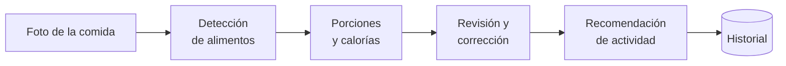
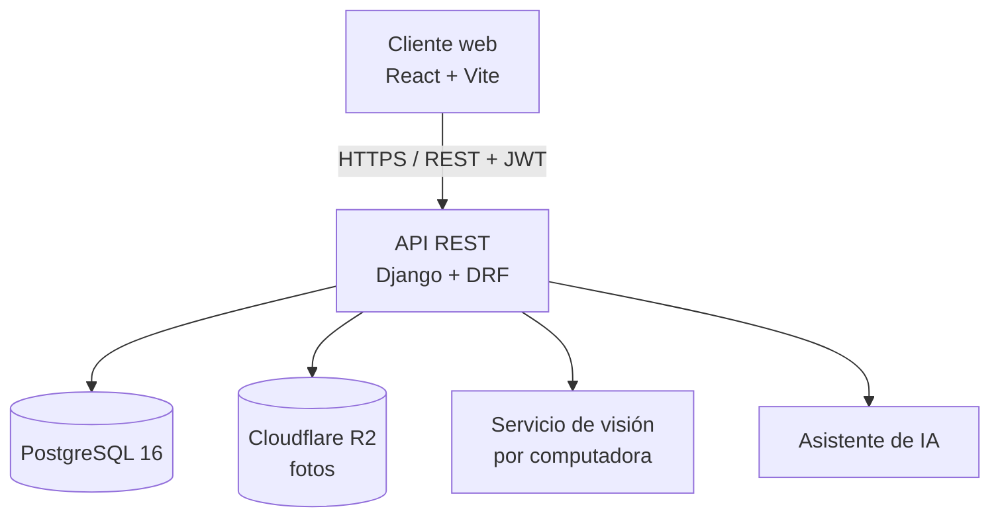
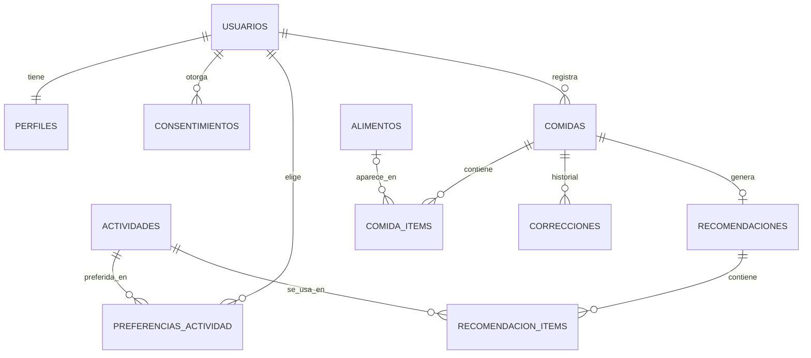

<p align="center">
  <!-- IMAGEN 1: banner o logo. Reemplazar por docs/img/banner.png (sugerido: 1280×320 px) -->
  
</p>
<h1 align="center">Panda</h1>
 
<p align="center">
  <strong>Estima las calorías de tu comida con una foto y descubre cómo equilibrarlas.</strong><br>
  Agente inteligente para estimación de calorías y recomendación de actividad física.
</p>
<p align="center">
  
  
  
  
  
</p>
<p align="center">
  <a href="#qué-es-panda">Qué es</a> ·
  <a href="#cómo-funciona">Cómo funciona</a> ·
  <a href="#arquitectura">Arquitectura</a> ·
  <a href="#modelo-de-datos">Datos</a> ·
  <a href="#primeros-pasos">Primeros pasos</a> ·
  <a href="#roadmap">Roadmap</a> ·
  <a href="#equipo">Equipo</a>
</p>
---
 
## Qué es Panda
 
Registrar lo que comes es tardado: hay que buscar cada alimento, estimar cantidades y capturar datos a mano. Y aun después de hacerlo, un número de calorías no dice mucho a quien no sabe qué significa en la práctica.
 
**Panda** reduce ese esfuerzo a una fotografía. Un servicio de visión por computadora identifica los alimentos del plato, estima sus porciones y calcula las calorías por alimento y en total, siempre como un **rango** y no como una cifra exacta. Después, el agente traduce ese número en algo comprensible: **alternativas de actividad física** con una duración estimada para equilibrar esa comida.
 
Panda también incluye un **asistente de IA** conversacional para resolver dudas sobre tu día y tus metas.
 
> Panda ofrece estimaciones orientativas. No emite diagnósticos ni sustituye la valoración de un nutriólogo, médico o entrenador.
 
## Capturas
 
<!-- IMAGEN 2: capturas de pantalla. Guardarlas en docs/img/screens/ con estos nombres. -->
<p align="center">
  
  
</p>
<p align="center">
  
  
</p>
## Funcionalidades
 
| Área | Qué incluye |
|---|---|
| **Análisis por foto** | Carga desde cámara o galería, detección de uno o varios alimentos, porciones y calorías por alimento y total, con rango y nivel de confianza |
| **Corrección** | Agregar, editar o eliminar alimentos y porciones; cada cambio queda registrado y la estimación original nunca se modifica |
| **Actividad física** | Lista de ejercicios con duración y sesiones según las calorías de la comida, tu peso y tus actividades preferidas |
| **Seguimiento** | Historial de comidas, calorías y recomendaciones, con estadísticas por periodo |
| **Asistente de IA** | Chat para consultar tu progreso y recibir sugerencias; su icono es una esfera verde |
| **Cuenta y privacidad** | Registro, perfil físico, consentimientos versionados, control sobre guardar tus fotos y eliminación completa de tu cuenta |
| **Administración** | Gestión de usuarios y catálogos de alimentos y ejercicios desde el panel de administración |
 
**Fuera del alcance:** diagnósticos médicos o nutricionales, prescripción de rutinas clínicas, medición exacta de porciones solo con una foto e integración con *wearables*.
 
## Cómo funciona
 

 
1. **Detección.** La imagen se analiza para identificar los alimentos visibles.
2. **Estimación.** La porción se calcula con base en la porción de referencia del catálogo y el tamaño relativo del alimento en la imagen. Las calorías se obtienen con la densidad energética del catálogo: `kcal = kcal por 100 g × porción (g) / 100`.
3. **Revisión.** El usuario confirma o corrige lo detectado. Si no se detecta nada o la confianza es baja, Panda lo avisa y marca el resultado como aproximado.
4. **Recomendación.** Se calcula la duración de cada actividad a partir de su valor MET, el peso del usuario y las calorías a equilibrar (`kcal = MET × peso (kg) × horas`). La fórmula se versiona para poder reproducir cada recomendación.
5. **Historial.** Todo se guarda para consultarlo después.
## Arquitectura
 

 
El backend está organizado en aplicaciones de Django con responsabilidades separadas: identidad, catálogos, comidas y recomendaciones. Las fotografías **no se guardan en la base de datos**: viven en Cloudflare R2 y la base solo conserva su clave. El servicio de visión se mantiene detrás de una interfaz propia, de modo que el modelo puede reemplazarse sin tocar el resto de la aplicación; cada análisis registra qué proveedor y versión lo generaron.
 
| Capa | Tecnología |
|---|---|
| Frontend | React, Vite, React Router |
| Backend | Python, Django 5.2 LTS, Django REST Framework, simplejwt |
| Base de datos | PostgreSQL 16 (`pg_trgm`, `unaccent`) |
| Almacenamiento de fotos | Cloudflare R2 |
| Autenticación | JWT con refresh token en cookie HttpOnly, contraseñas con Argon2id |
| Gestión del proyecto | Scrum, JIRA, Git |
 
## Modelo de datos
 

 
Decisiones de diseño destacadas:
 
- **Auditoría inmutable.** La estimación original de la IA se guarda una sola vez y cada cambio del usuario genera una fila de corrección.
- **Historial estable.** Cada alimento de una comida conserva una copia de su densidad energética, así que actualizar el catálogo no altera lo registrado.
- **Integridad en la base.** Restricciones `CHECK`, claves foráneas con `ON DELETE` definido y catálogos que se desactivan en lugar de borrarse.
- **Identificadores no enumerables.** Los datos que expone la API usan UUID.
El esquema completo, con el SQL de referencia, los índices y la estrategia de migraciones, está en [`docs/DISENO_BASE_DE_DATOS.pdf`](docs/DISENO_BASE_DE_DATOS.pdf).
 
## Privacidad y seguridad
 
Panda maneja datos de salud (peso, hábitos alimenticios) y fotografías, por lo que los trata como información sensible.
 
- Solo pueden registrar comidas las personas mayores de 18 años que hayan aceptado los tres avisos (privacidad, avisos de salud y procesamiento por terceros) en su versión vigente.
- Cada usuario accede únicamente a sus propios datos.
- Comunicaciones cifradas con TLS y objetos cifrados en reposo en Cloudflare R2.
- Roles de base de datos separados: uno para migraciones, otro para la API y otro de solo lectura sin acceso a contraseñas ni tokens.
- Los borradores sin confirmar se eliminan a las 24 horas.
- Eliminar una comida o la cuenta borra los datos y las fotos de inmediato.
- Respaldos diarios con 7 días de retención.
 
## Estructura del repositorio
 
```text
panda/
├── backend/      # API REST con Django (identidad, catálogos, comidas, recomendaciones)
├── frontend/     # Aplicación web con React + Vite
├── docs/         # Documentación, diagramas e imágenes
│   └── img/      # Banner y capturas de pantalla
└── README.md
```
 
## Roadmap
 
- [x] Documento de visión y requisitos
- [x] Diseño de base de datos v0.2 (PostgreSQL + Django)
- [x] Prototipo de la página de presentación y de las pantallas de acceso
- [ ] Onboarding: consentimientos, perfil físico y preferencias de actividad
- [ ] Análisis de comidas por fotografía, con revisión y corrección
- [ ] Recomendaciones de actividad física
- [ ] Historial y estadísticas por periodo
- [ ] Asistente de IA conversacional
- [ ] Meta de peso, hidratación y entrenamientos (requiere ampliar el esquema)
- [ ] Panel de administración de catálogos
## Equipo
 
Proyecto académico de **Ingeniería en Sistemas Computacionales** del **Instituto Tecnológico de Jiquilpan**, Michoacán · Septiembre 2026.
 
| Integrante | Rol principal | Participación técnica |
|---|---|---|
| Ludwig Iván Ortiz Sierra | Scrum Master (rotativo) | Programación, integración, pruebas y documentación |
| Estefania López Rivas | Product Owner | Análisis de requerimientos, backend, pruebas y validación funcional |
| Sergio Octavio Cervantes Múgica | Development Team | Interfaz de usuario, integración con el agente de IA, pruebas y documentación |
 
**Docente:** Leoardo Martinez Gonzales
 
### Forma de trabajo
 
El desarrollo sigue **Scrum**, con entregas incrementales y rotación del rol de Scrum Master entre los tres integrantes.
 
- Las tareas importantes se registran en JIRA antes de empezar.
- Se trabaja en ramas de Git; la versión estable no se modifica directamente.
- Los cambios se revisan antes de integrarse a la rama principal.
- Cada funcionalidad se prueba antes de marcarse como terminada.
- Los bloqueos se comunican al equipo y la documentación se mantiene actualizada.
## Documentación relacionada
 
- [Documento de Visión del Proyecto](docs/VISION_DE_PROYECTO.pdf)
- [Diseño de Base de Datos](docs/DISENO_BASE_DE_DATOS.pdf)
